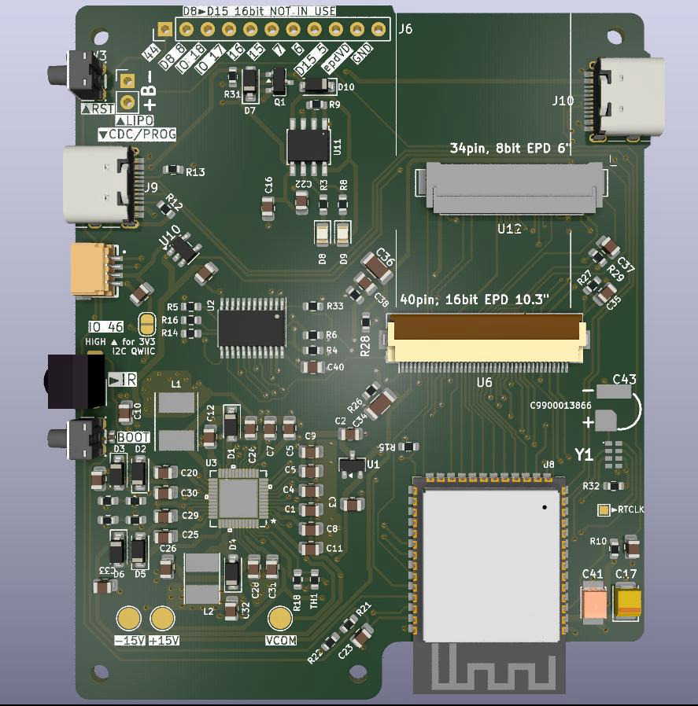
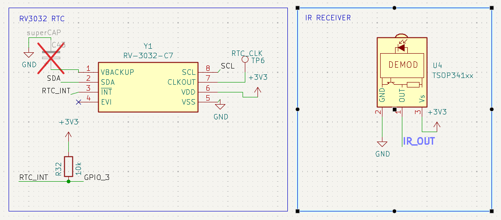

## H-epdiy-boards list of open source variations

This boards where made with collaboration from Larry Bank and support from the [NLnet foundation](https://nlnet.nl).
Each variation is targeted for different needs. Intended for everyone to make their own custom modifications. For example: You don't need one of the eink connectors, or you don't need RTC, then just remove it from the Pick and place order. For more advanced users you can of course open the board in KiCad and reorganize stuff.
Pull Requests with variations or fixes are welcome.
Any of this circuits is made or designed with AI. They are all human reviewed and crafted carefully.

### epdiy-model-F

**What it provides:**

- A 40 pin connector for 16 bit Eink displays like ED103TC2 or ED103MC2
- 8 free GPIOs exposed if you don't use the 16 bit display
- A 34 pin connector for 8 bit Kindle like Eink displays (All the ED060***)
- Double USB-C connector w/built in USB only (no UART)
- A single BOOT / USER button (IO 0)
- An IR receiver TSOP341 (LCSC: C118303)
- RV3032 RTC with the INT pin connected to IO3 (RTC GPIO so you can wake up the MCU)
- Switchable QWIIC power so you can switch on a peripheral and cut it's power completely
- TP4056 battery charger

The IR is meant so you can make a simple Firmware and change the display content with  your TV remote.

How it looks like:

Some features like RTC and IR receiver:

[Full schematics PDF](epdiy-v7-model-F/v7-model-f_1.0.pdf)

## Links of interest

[How to read codes from IR Remote controls](https://bitbanksoftware.blogspot.com/2026/11/how-to-read-codes-from-many-ir-remote.html) Good article from Larry about receiving IR codes

[IDF Nec IR receive example](https://github.com/espressif/esp-idf/tree/master/examples/peripherals/rmt/ir_nec_transceiver) if you like ESP-IDF, just set the RX pin in **main/ir_nec_transceiver_main.c** to 43, make a **set-target esp32s3** and you are ready for an **idf.py flash monitor**

[sensoria board](https://fasani.de/2026/01/16/new-product-and-service-launched-sensoria/) A new product we are launching with a 5.2 inch variation of a FastEPD board

[FastEPD](https://github.com/bitbank2/FastEPD) An alternative and different library than epdiy to control raw parallel eink displays

If anyone makes a great Firmware to interact with an online image gallery and receive IR commands, then he can claim a 50% discount and free shipping in any of my boards sold on Tindie (I will send a Coupon)
PRE-REQUISITES: It should be code by hand with carefully clean code. Detection that is made with Claude or any other AI coding tool leaves you out of the contest.  You need to provide proof of commit history exactly for that reason.